# Lab4Web - Praktikum 4: CSS Layout

Nama : Fuad Muhammad Adfal  
NIM : 312510262  
Kelas : I251A  
Mata Kuliah : Pemrograman Web  

---

### Membuat Box Element
Menambahkan elemen `<section>` yang berisi tiga `
` dengan class berbeda (`div1`, `div2`, `div3`). Setiap `div` berperan sebagai satu "kotak" (box). Secara default, `div` adalah elemen *block* sehingga tampil menumpuk ke bawah.

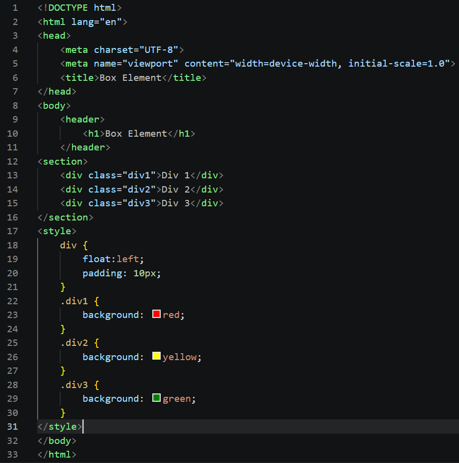  
  

### CSS Float Property
Menambahkan blok `<style>` pada `<head>`. Properti `float: left` membuat setiap `div` "mengambang" ke kiri sehingga tersusun **berdampingan** secara horizontal, bukan menumpuk. `padding` memberi jarak antara isi dan tepi box, sedangkan `background` memberi warna berbeda agar setiap box mudah dibedakan.

  
  

### Mengatur Clearfix
Elemen yang berada setelah elemen float akan ikut "naik" dan menyesuaikan posisi float tersebut. Untuk mengatasinya, ditambahkan `div4` dengan properti `clear` agar elemen ini tampil di bawah elemen float sebelumnya, dan `float: none` agar tidak ikut mengambang. Praktikan juga diminta bereksperimen dengan nilai `clear` lain (`left`, `right`, `both`) untuk memahami pengaruhnya.

  
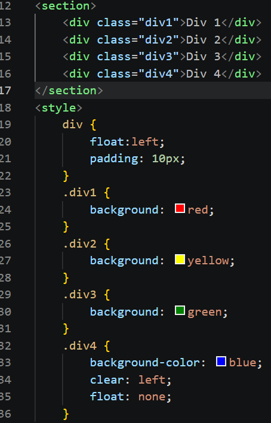  

### Membuat Layout Sederhana
Halaman dibagi ke dalam elemen semantik HTML5 sesuai fungsinya:
- `<header>`: bagian kepala/judul situs
- `<nav>`: menu navigasi
- `<section id="hero">`: panel utama/banner
- `<section id="wrapper">`: pembungkus area konten, berisi `<section id="main">` (konten utama) dan `<aside id="sidebar">` (sidebar)
- `<footer>`: bagian kaki halaman

Pada tahap ini tampilan masih polos karena belum ada CSS.

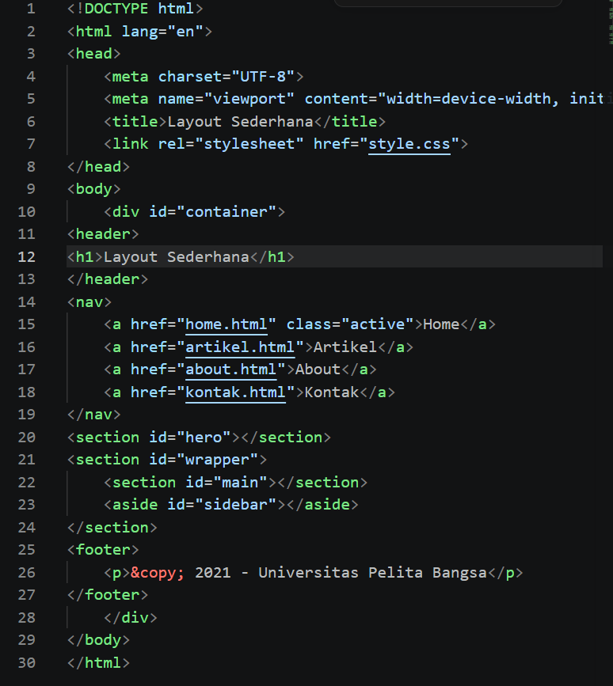  
  

Mengimpor font **Open Sans** dari Google Fonts, lalu menerapkan *reset CSS* (`margin` dan `padding` diatur ke 0) agar tampilan konsisten di semua browser. Selain itu diatur gaya dasar `body` (font, ukuran, warna teks) dan `#container` (lebar tetap, posisi di tengah, serta bayangan tipis).

  
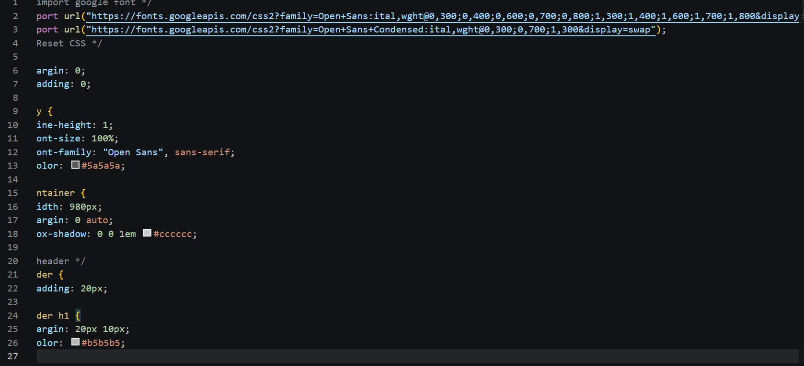  

### Membuat Navigasi
Menu diberi latar biru dan link dibuat `inline-block` agar tersusun mendatar dengan padding yang nyaman diklik. Link diberi teks putih tanpa garis bawah. Link yang aktif atau saat di-*hover* berubah warna latar sebagai penanda interaksi.

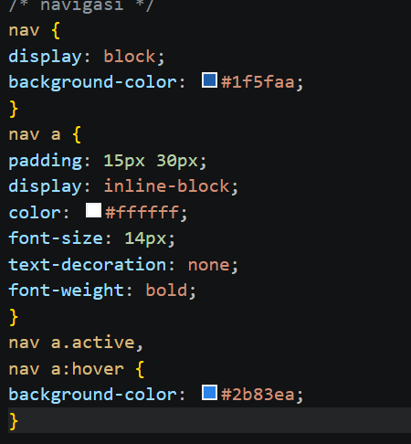  
  

### Membuat Hero Panel
Menambahkan konten HTML pada section `hero`: judul, paragraf, dan tombol *Learn more*. CSS memberi latar abu-abu, padding, margin, serta ukuran font dan jarak baris pada judul dan paragraf agar menonjol sebagai bagian pembuka halaman.

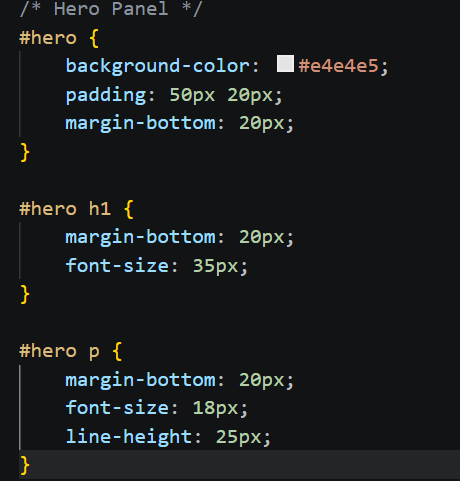  
  
  

### Mengatur Layout Main dan Sidebar
Menggunakan **float** untuk membuat tampilan dua kolom. `#main` (lebar 640px) dan `#sidebar` (lebar 260px) sama-sama di-float ke kiri sehingga sejajar. Total lebar kedua kolom (beserta padding) menyesuaikan lebar container 980px.

  
  

Mengisi sidebar dengan dua widget (`widget-box`): satu berisi daftar link, satu berisi teks. CSS memberi border tipis, judul widget berlatar biru, daftar tanpa bullet, serta efek hover pada link agar lebih interaktif.  

  
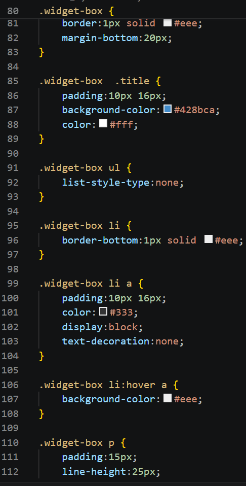  

### Mengatur Footer
Footer diberi `clear: both` agar berada di bawah kedua kolom yang di-float dan tidak naik ke samping. Selain itu diberi latar gelap, padding, dan teks berwarna terang.

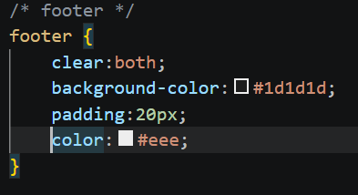  
  

### Menambahkan Elemen pada Main Content
Menambahkan tiga kolom `.box` di dalam `.row`, masing-masing berisi gambar bulat, heading, deskripsi singkat, dan tombol *View detail*. CSS yang digunakan:
- Setiap box memakai lebar 33.33% dan di-float ke kiri, sehingga tersusun tiga kolom sejajar.
- `box-sizing: border-box` agar padding tidak menambah lebar total elemen.
- `border-radius: 50%` membuat gambar berbentuk lingkaran.
- Teknik clearfix dengan `:before` dan `:after` pada `.row` agar container tetap membungkus elemen yang di-float.

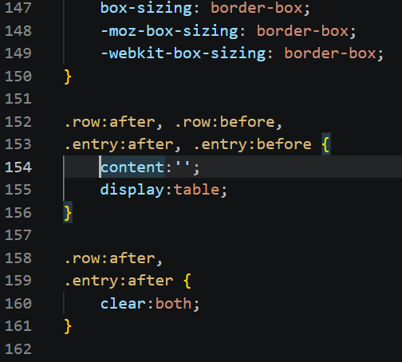  
  
  

### Menambahkan Content Artikel
Menambahkan dua `<article class="entry">` yang dipisahkan garis pembatas (`
`). Masing-masing berisi heading, gambar, dan paragraf. Gambar pada artikel pertama di-float ke kiri dan pada artikel kedua ke kanan, sehingga teks mengalir di sisi gambar. CSS juga mengatur margin, jarak antar elemen, sudut gambar yang membulat, dan gaya garis pembatas.

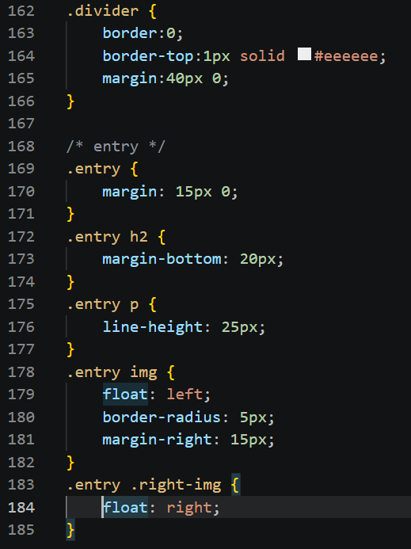  
  
  

### Menambahkan Layout Untuk Menu About

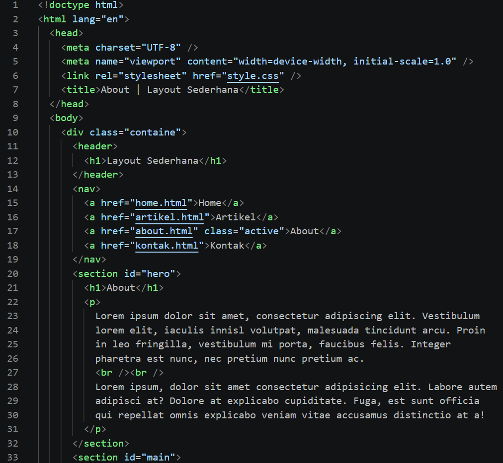  
  
  
  
  

### Menambahkan Layout Untuk Menu Contact

  
  
  
  